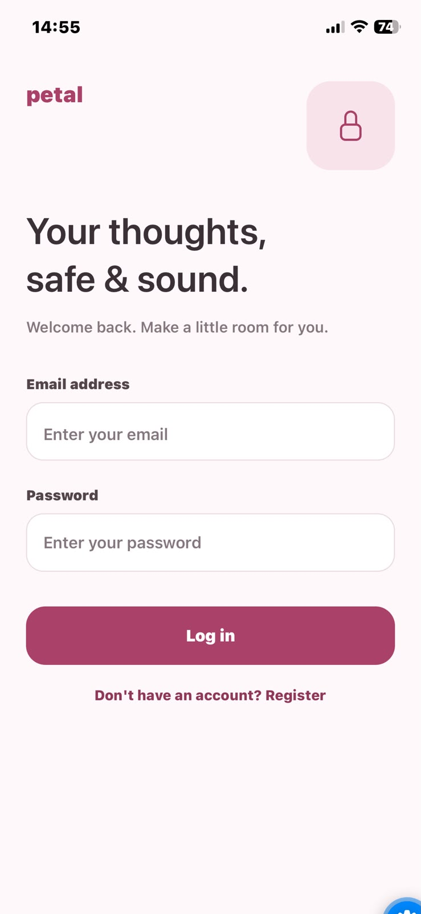
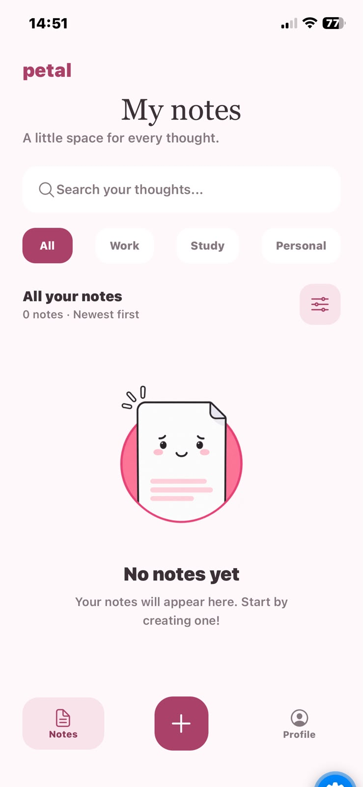
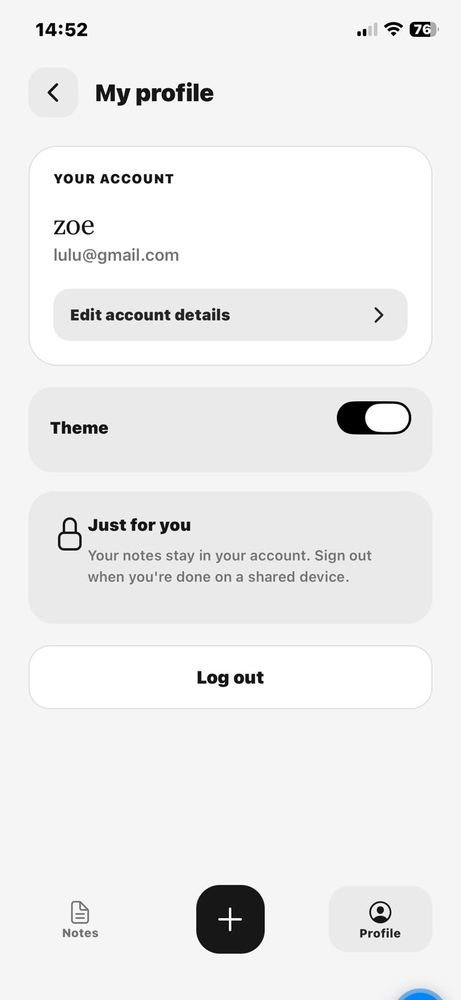
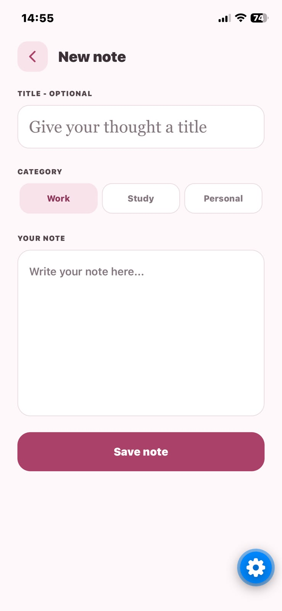

# React Native Notes Application

## 1. Project Overview

The React Native Notes Application is a mobile application that allows users to register, log in and manage their personal notes.

Users can create, view, edit, delete, search and organise notes into different categories. The application also provides account management functionality and stores user information and notes locally using AsyncStorage.

The application is developed using React Native, Expo and TypeScript.

## 2. Features

### 2.1 User Management

- **User Registration:** Users can create an account using a username, email address and password.
- **User Login:** Registered users can log in using their email address and password.
- **Password Hashing:** Passwords are hashed before being stored.
- **Protected Navigation:** Users must be logged in to access the application's main screens.
- **Session Persistence:** Login sessions are saved locally.
- **Profile Management:** Users can update their username and email address.
- **Password Management:** Users can change their password after confirming their current password.
- **Email Validation:** The application prevents users from registering or updating their account with an email address already used by another account.
- **Logout:** Users can securely log out of their accounts.

### 2.2 Notes Management

- **Add Notes:** Users can create new notes.
- **Optional Titles:** Notes can have a title or be saved without one.
- **Note Content:** Each note must contain text.
- **Date Added:** The application automatically records when a note is created.
- **View Notes:** Users can view all their saved notes.
- **Edit Notes:** Users can modify existing notes.
- **Date Edited:** The application records when a note was last edited.
- **Delete Notes:** Users can delete existing notes after confirming the deletion.
- **User-Specific Notes:** Each user can only access their own notes.

### 2.3 Note Categories

Notes are organised into three categories:

- Work
- Study
- Personal

Each category has its own screen where users can view and manage notes belonging to that category.

### 2.4 Search Functionality

- Users can search for notes by entering words into the search field.
- Searches match words in both note titles and note content.
- Searches are case-insensitive.
- Every word entered in the search field must match somewhere in the note title or content.

### 2.5 Sorting Functionality

Users can sort notes according to their date added:

- **Newest First:** Displays the most recently added notes first.
- **Oldest First:** Displays the earliest added notes first.

Sorting is available on the Home, Work, Study and Personal notes screens.


## Application Preview









## 3. Technologies Used

| Technology | Purpose |
|---|---|
| React Native | Mobile application development |
| Expo | Development and application runtime |
| TypeScript | Type-safe application development |
| React | Component-based user interface |
| React Navigation | Screen navigation |
| Native Stack Navigator | Stack-based navigation |
| Bottom Tab Navigator | Tab navigation dependency |
| AsyncStorage | Local data storage |
| bcryptjs | Password hashing and verification |
| React Native Safe Area Context | Safe area handling |
| React Native Screens | Native screen support |

## 4. Project Structure

```text
NotesApp/
│
├── src/
│   │
│   │
│   ├── navigation/
│   │   ├── AppNavigator.tsx
│   │   └── types.ts
│   │
│   ├── screens/
│   │   ├── LoginScreen.tsx
│   │   ├── RegisterScreen.tsx
│   │   ├── HomeScreen.tsx
│   │   ├── WorkNotesScreen.tsx
│   │   ├── StudyNotesScreen.tsx
│   │   ├── PersonalNotesScreen.tsx
│   │   ├── AddNoteScreen.tsx
│   │   ├── EditNoteScreen.tsx
│   │   ├── ProfileScreen.tsx
│   │   └── NoteDetailsScreen.tsx
│   │
│   ├── context/
│   │   └── AuthContext.tsx
│   │
│   └── storage/
│       └── storage.ts
│
├── App.tsx
├── package.json
├── tsconfig.json
└── README.md
```

## 5. Requirements

Before running the application, ensure that you have installed:

- Node.js (LTS version recommended).
- npm (included with Node.js).
- Expo-compatible development environment.
- Expo Go on an Android or iOS device, or an Android emulator.

An internet connection may be required for installing dependencies and downloading the Expo development bundle.

## 6. Installation Instructions

### Step 1: Download or Clone the Project

Clone the GitHub repository:

```bash
git clone YOUR_GITHUB_REPOSITORY_URL
```

Alternatively, download the project and extract it to your computer.

### Step 2: Open the Project Folder

Open a terminal and navigate to the project directory:

```bash
cd NotesApp
```

### Step 3: Install Dependencies

Run:

```bash
npm install
```

This installs the dependencies listed in `package.json`.

## 7. Running the Application

### Step 1: Start the Expo Development Server

Inside the project directory, run:

```bash
npx expo start
```

This starts the Expo development server and displays a QR code in the terminal.

### Step 2: Open the Application

**Option A: Using a Physical Phone**

1. Install Expo Go on your phone.
2. Connect your phone and computer to the same Wi-Fi network.
3. Open Expo Go.
4. Scan the QR code displayed in the terminal.
5. Wait for the application to load.

**Option B: Using an Android Emulator**

1. Start your Android emulator.
2. Run the Expo development server:

```bash
npx expo start
```

3. Press `a` in the terminal to open the application on Android.

### Step 3: Use the Application

Once the application has loaded:

1. Register a new account.
2. Log in to access the application.
3. Create notes and assign categories.
4. View, edit and delete notes.
5. Search and sort notes.
6. Open your profile to update your account details.

## 8. TypeScript Validation

The project uses TypeScript to help identify errors before running the application.

To check for TypeScript errors, run:

```bash
npx tsc --noEmit
```

If the command finishes without displaying errors, the TypeScript check has passed.

## 9. Data Storage

The application uses AsyncStorage to store information locally on the device.

The following information is stored:

- Registered user accounts.
- Hashed user passwords.
- Current login session.
- Notes created by users.
- Note categories.
- Note creation dates.
- Note editing dates.

The application separates notes according to the logged-in user's account.

**Note:** AsyncStorage is local device storage and is not a cloud database. Application data is not automatically synchronised between different devices.

## 10. Navigation

The application uses React Navigation to manage movement between screens.

The main screens include:

- Login
- Register
- Home
- Work Notes
- Study Notes
- Personal Notes
- Add Note
- Edit Note
- Note Details
- Profile

Protected navigation ensures that logged-out users are directed to the authentication screens.


## 11. Conclusion

The React Native Notes Application provides a simple and organised way for users to manage their notes.

It includes user authentication, protected navigation, profile management, note management, category organisation, searching, sorting and local data persistence.

The application was developed using React Native, Expo and TypeScript, with AsyncStorage used for local data storage.
